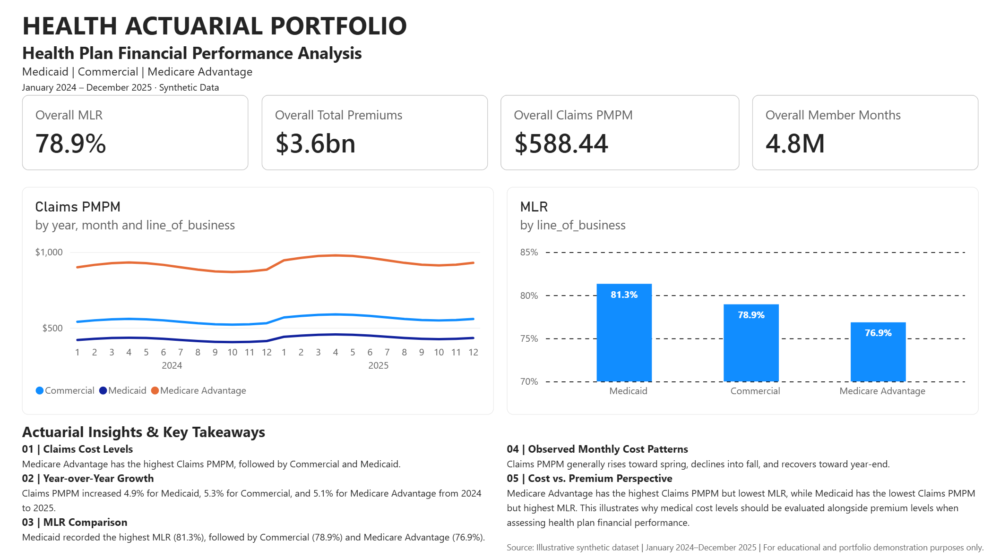
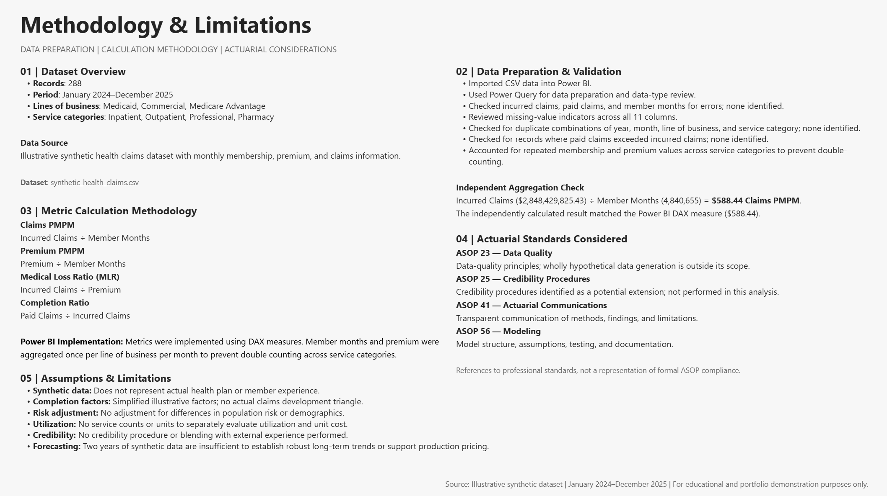
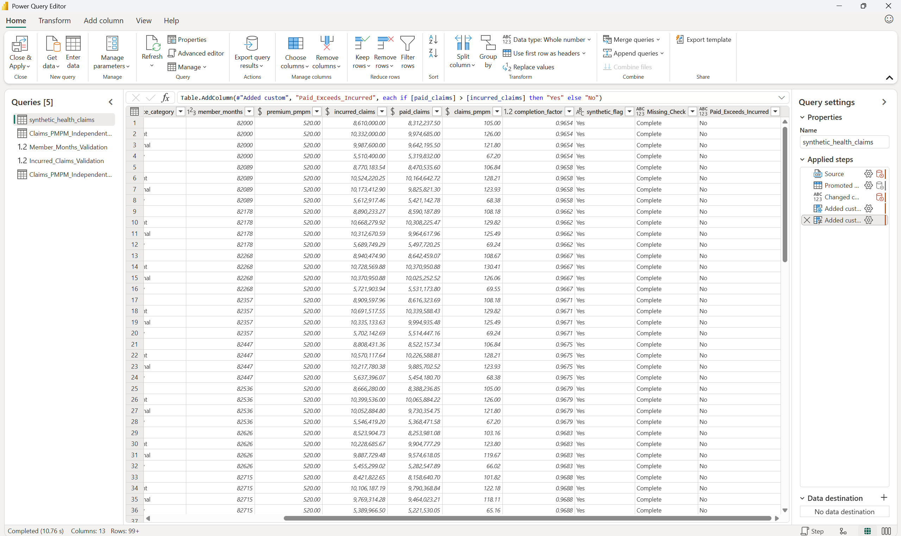

# **Health Plan Financial Performance Analysis**

## **Project overview**

This project uses an illustrative synthetic health claims dataset to demonstrate a Power BI workflow for summarizing health plan financial performance across Medicaid, Commercial, and Medicare Advantage.

The report contains two pages:

1. **Executive Summary** — portfolio-level key performance indicators and line-of-business comparisons, including MLR and Claims PMPM year-over-year growth.  
2. **Methodology & Limitations** — dataset description, data preparation and validation steps, metric definitions, actuarial standards considered, and project limitations.

This is an educational portfolio project. It is not based on actual insurer, provider, member, or CMS data and is not intended for production pricing, reserving, or forecasting.

## **Dashboard Preview**

### Executive Summary

### Methodology & Limitations

### Data Quality Checks

## **Project files**

* `Health_Plan_Financial_Performance_Analysis.pbix` — Power BI report.  
* `synthetic_health_claims.csv` — source dataset used by the report.  
* `Health_Plan_Financial_Performance_Calculations.xlsx` — supporting workbook containing the raw data and spreadsheet calculations for MLR and Claims PMPM year-over-year growth.  
* `README.md` — this project overview.

## **Dataset**

The synthetic dataset contains 288 records covering January 2024 through December 2025:

* 3 lines of business: Medicaid, Commercial, and Medicare Advantage.  
* 4 service categories: Inpatient, Outpatient, Professional, and Pharmacy.  
* 24 monthly observations for each line of business and service category.

The fields include year, month, line of business, service category, member months, premium PMPM, incurred claims, paid claims, claims PMPM, completion factor, and a synthetic-data indicator.

**Important aggregation note:** Member months and premium PMPM are repeated across the four service-category records for a given line of business and month. They must not be summed across all four categories. The report's calculations account for this repetition so that membership and premium are counted once per line of business and month, while service-category claims are aggregated across categories.

## **Metrics**

* **Claims PMPM** \= Incurred Claims ÷ Member Months  
* **Premium PMPM** \= Premium ÷ Member Months  
* **Medical Loss Ratio (MLR)** \= Incurred Claims ÷ Premium  
* **Paid-to-Incurred Ratio** \= Paid Claims ÷ Incurred Claims  
* **Claims PMPM YoY Growth** \= (2025 Claims PMPM ÷ 2024 Claims PMPM) − 1

The report uses DAX measures for the displayed metrics. The supporting calculations workbook separately reproduces the line-of-business MLR and Claims PMPM year-over-year growth calculations in Google Sheets using the same synthetic source data. The resulting percentages match the corresponding Power BI report values:

| Line of business | MLR | Claims PMPM YoY growth |
| :---- | :---- | :---- |
| Medicaid | 81.3% | 4.9% |
| Commercial | 78.9% | 5.3% |
| Medicare Advantage | 76.9% | 5.1% |

For MLR, incurred claims are aggregated across service categories. Premium is calculated using premium PMPM multiplied by member months, counting the repeated member-month and premium PMPM values once per line of business and month.

For annual Claims PMPM, incurred claims are divided by member months for the applicable year and line of business. Member months are counted once per line of business and month, using the Inpatient records to avoid double-counting repeated values across service categories. YoY growth compares the resulting 2025 Claims PMPM with 2024 Claims PMPM.

These spreadsheet calculations provide a separate calculation path for the reported MLR and YoY growth percentages. Matching results do not establish that the synthetic source data or its assumptions represent real-world experience.

## **Data preparation and validation**

Power Query was used to review data types and prepare the source data. The project also includes checks for missing-value indicators, duplicate combinations of year/month/line of business/service category, query errors in selected numeric fields, and records where paid claims exceed incurred claims.

An additional Claims PMPM aggregation check in Power Query separately aggregated incurred claims and member months, then divided the resulting totals. It produced:

* Total incurred claims: **\$2,848,429,825.43**  
* Total member months: **4,840,655**  
* Independent Claims PMPM: **\$588.44**

The independent result matched the report's DAX Claims PMPM to two decimal places. This is an internal calculation check; it does not establish that the synthetic source data represents real-world experience or independently validate every report measure.

## **Assumptions and limitations**

* All records are synthetic and illustrative.  
* Completion factors are illustrative assumptions, not factors developed from an actual claims development triangle.  
* The dataset does not include utilization counts or service units; therefore, it cannot support a true utilization and unit-cost decomposition.  
* It does not include member-level risk scores, risk adjustment, credibility weighting, or external experience blending.  
* Two years of synthetic observations are not sufficient to establish robust long-term trends or support production pricing decisions.  
* The project is a demonstration of data preparation, aggregation, calculation, visualization, and communication—not a production actuarial model.

## **Actuarial standards context**

The methodology page identifies ASOP 23 (Data Quality), ASOP 25 (Credibility Procedures), ASOP 41 (Actuarial Communications), and ASOP 56 (Modeling) as standards considered when thinking about professional actuarial work.

Their inclusion is contextual. This synthetic educational exercise should not be represented as a formal compliance review or as an assertion that each standard applies to the project in the same way it would to an actuarial assignment.

## **How to view**

Open `Health_Plan_Financial_Performance_Analysis.pbix` in Power BI Desktop. Keep the source CSV in the same project folder as the PBIX if the report needs to be refreshed or the query steps inspected. The supporting calculations workbook can be opened in Google Sheets or Microsoft Excel.

